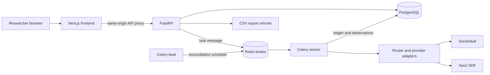
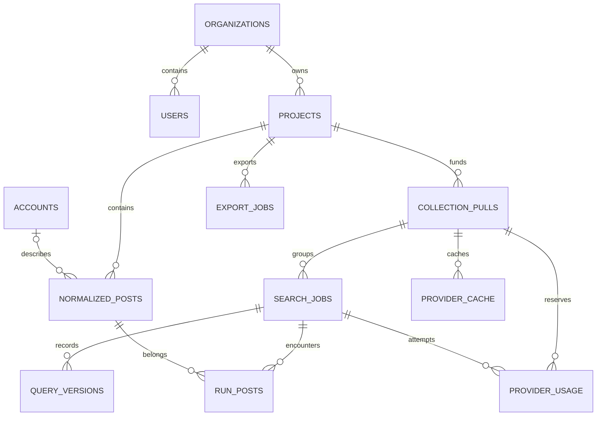
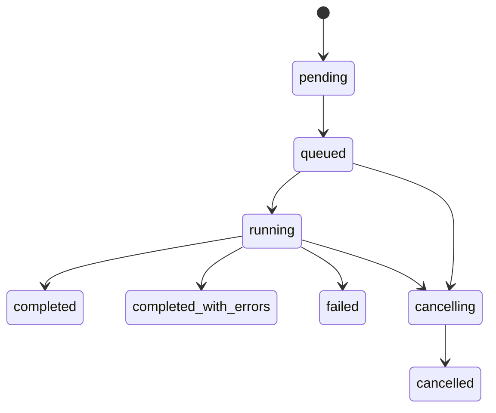

 # SocialScope learning handbook

Version 0.1.0 pilot. This describes this repository, including its limitations. Read [START_HERE](../START_HERE.md) for installation, [collection feasibility](COLLECTION_FEASIBILITY.md) for provider evidence, [TESTING_GUIDE](../TESTING_GUIDE.md) for actual validation, and the separate [roadmap](ROADMAP.md) for deferred work. No production usage or performance measurements are claimed.

## 1. Application overview

SocialScope helps a small research group define a question, search social sources, inspect relevance, collect within limits, exclude irrelevant observations, and export data with provenance. Questions might concern public transport accessibility, local climate adaptation, or college costs. A search result is an observation returned by a vendor, not proof that all matching posts were retrieved. A preview is not a probability sample.

A **project** is the durable home for a research question and dataset. A **pull** is a spending allowance covering related previews, query revisions, and at most one full collection. A **run** is one execution within that pull. These distinctions matter: another preview must not silently replenish the comparison allowance. The researcher explicitly selects New pull for another allowance; previous runs remain visible.

SocialPulse supplied the Next.js/FastAPI/PostgreSQL/Celery structure, provider adapters, timestamp parsing, paging safeguards, cancellation, filtering, charts, authentication, and CSV export. SocialScope changes the purpose and data model while preserving valuable integration behavior. Recruitment routes, flags, signals, classification tasks, navigation, and candidate dashboards are removed. Author context remains. No replacement classification pipeline or automatic paid AI analysis was added.

Pilot testers use the administrator's shared SociaVault and Xpoz accounts. Each installation has an independent database and ledger. A local allowance cannot coordinate money spent by another installation using the same credentials. This boundary cannot be fixed by changing a port.

## 2. Architecture



The frontend presents state and submits requests; it does not hold provider keys or enforce spending policy. FastAPI authenticates callers, verifies project organization, validates configuration, and creates jobs. PostgreSQL is the source of truth for data and budgets. Redis carries task messages/results; it is not the authoritative research record. Celery executes collection outside HTTP requests. Beat periodically enqueues abandoned-run reconciliation. These are separate processes sharing one backend codebase.

Project creation, data reads, exclusion, and analytics are synchronous HTTP operations. Collection is asynchronous: the API commits a job, publishes a message, and returns an identifier. The browser polls stored progress. CSV generation currently runs in the API request through ExportService, despite using an ExportJob record. A table named job does not make its work asynchronous. This is simple at pilot sizes; large exports should move to a queue later.

Background jobs avoid holding a browser request open during pagination, backoff, and multi-minute SDK operations. A researcher can leave and return to a run. They also create failure boundaries: database commit, broker publication, external billing, and persistence are separate events. No transaction spans them all. Reliability comes from durable records, conservative reservations, idempotent writes, and honest partial outcomes.

## 3. Repository guide

```text
socialscope/
  docker-compose.yml       topology, ports, named volumes
  .env.example             configuration names without provider keys
  backend/
    app/main.py            route registration and exception handling
    app/config.py          typed environment settings
    app/database.py        async engine and request-session dependency
    app/models/            SQLAlchemy database model
    app/schemas/           Pydantic transport contracts
    app/routes/            HTTP boundary and authentication dependencies
    app/services/          project, search, budget, results, analytics, export
    app/adapters/          providers, retries, pagination, parsing, cancellation
    app/workers/           Celery registration and orchestration
    alembic/versions/      ordered schema changes
    tests/                 offline fixtures; optional PostgreSQL locking test
  frontend/
    src/app/               Next.js routes and layouts
    src/components/        navigation, controls, charts
    src/lib/               API, sessions, collection-state utilities
    tests/                 Node-based behavior tests
  scripts/                 setup, connectivity, offline benchmark tools
  docs/                    handbook, roadmap, evidence, feedback
```

Start a collection trace in `routes/search_jobs.py`, then `SearchService.create_job` in `services/search_service.py`. Follow the task into `workers/tasks.py::run_collection_job`, `services/platform_collection.py`, `adapters/router.py`, and the selected adapter. Follow each paid attempt from `ProviderRequestController` in `adapters/provider_limits.py` into `BudgetContext` in `services/budget_service.py`.

For results, read `models/normalized_post.py` and `models/collection_pull.py::RunPost`, then `services/post_service.py` and `frontend/src/app/(dashboard)/projects/[id]/results/page.tsx`. For an exported row, follow `ExportService._generate_csv` and `_write_csv`. These paths explain relationships better than an alphabetical inventory.

Some inherited compatibility structures remain: historical migrations, inactive analytics-summary schema/model definitions, and account-label columns. They do not imply active recruitment or AI workers. Keeping the migration chain permits a fresh database to reach the current schema without rewriting history. Some inactive adapter branches and fixture generators remain alongside their tests. Runtime source validation permits only the six pilot sources.

## 4. End-to-end request walkthrough

Consider a public-transit project with an optional August period. New Project sends `POST /api/projects`. `ProjectService.create_project` stores the question, description, and defaults. No provider spending occurs. Project settings are editable context; each execution stores its own original configuration.

Collections sends `POST /api/projects/{id}/jobs` with `mode: "preview"`. Pydantic and query validation check supported sources, query size, target bounds, and date order. `SearchService.create_job` creates or locks a CollectionPull. Existing pulls keep their sources and allowances. An active run causes HTTP 409. A matching completed preview within 900 seconds may return its existing job rather than queue another request.

For new work, the service computes allocations, creates SearchJob and QueryVersion, assigns a Celery task ID, and commits before publishing. A worker cannot read configuration before that configuration exists. Detected publication failures mark a run failed with a queue error. A process crash between commit and publish remains a known gap; a transactional outbox is a future solution.

The worker claims only pending/queued work, snapshots settings, monitors cancellation, and creates platform requests. A full run attaches same-pull, same-fingerprint preview memberships before collecting. Sources with zero allocation skip provider calls. Missing credentials are explicit outcomes, not fake data.

For SociaVault, `_get` checks a pull-scoped response cache. A miss reaches the request controller, which applies concurrency/rate safeguards and wraps **each attempt** with budgeting. The budget transaction locks the pull, checks cumulative request/credit/post limits, inserts a debit, and commits before network access. Timeouts retain their debit. A usable `credits_used` response records reported usage; otherwise the documented cost remains an estimate.

Adapters preserve vendor page parameters, parse normalized records, and track repeated cursors, no progress, duplicates, malformed dates, and out-of-range data. At platform completion or a partial-result return, `_persist_platform_posts` writes project-unique observations and RunPost memberships. It locks the pull while accepting observations so parallel platform persistence cannot exceed 5,000 unique posts across all the pull's runs.

Collections polls active runs. Results reads the project dataset, optionally filtered by run membership, text, source, dates, and inclusion. Exclusion changes this project's analysis state. Export joins membership to run/query context and writes a JSON provenance field. A post seen by two runs appears once in the project export with two context entries.

## 5. Database modeling



UUID primary keys identify entities; they are not authorization. Foreign keys prevent orphan associations and use cascades for owned records. Services verify organization ownership using the authenticated user. A browser-supplied project UUID is insufficient to grant access.

`normalized_posts` is unique on `(project_id, platform, external_id)`. Platform prevents unrelated identifiers from colliding. Project makes inclusion/exclusion research-specific. The retained `search_job_id` is the first-observation origin, not the complete membership relation. `run_posts` has primary key `(job_id, post_id)` and an encounter timestamp. `collected_at` records the stored observation; `encountered_at` records a run association.

Persistence uses PostgreSQL `INSERT ... ON CONFLICT DO NOTHING`, resolves an existing project record if needed, and inserts membership. Repeating persistence cannot duplicate those rows. Content remains the first stored observation; this is not a longitudinal record of edits or engagement changes. Account fields may refresh. Accounts are still looked up globally by platform/username; a stronger tenant-specific author model is future work.

CollectionPull holds source selection, fixed comparison/per-platform/request allowances, and the full-job marker. The service locks this row when creating a full job, preventing two full runs on one pull. Database comparison checks enforce the 5?8 range. ProviderUsage holds the responsible job/source/endpoint, reservation, estimate, reported value, and state. Foreign-key indexes support ledger/history lookups; RunPost's post index supports reverse provenance.

Exclusion is a boolean on the project observation. It preserves the row, memberships, and source link. Results defaults to included scope; analytics always excludes excluded rows; exports allow included/excluded/all. There is no immutable exclusion-decision history. A generated export captures scope at generation time and is not rewritten after a later restoration.

Transaction boundaries are deliberate:

1. Create configuration and commit before task publication.
2. Lock pull, validate ledger, insert reservation, commit before paid request.
3. Lock usage row and settle the outcome separately.
4. Persist a platform's observations/memberships/counts transactionally.
5. Verify ownership and update exclusion through the request session.

The provider network call does not hold a database transaction open. Holding a pull lock during minutes of SDK work would block unrelated platform progress. A committed debit survives crashes and releases the lock quickly. A crash before the actual request may conservatively overcount usage; automatically re-spending an ambiguous amount would be riskier.

Migration `012_research_pilot.py` creates pull/usage/cache/membership tables, backfills legacy membership, merges project duplicates while preserving encounters, and removes recruitment tables/columns. Legacy jobs may have no pull; workers refuse unbudgeted execution. Downgrade is intentionally not lossless. Restore a tested pre-migration backup instead. SocialScope starts independently and does not require copying SocialPulse's database.

An alternative is one full post copy per run, deduplicated only at read time. It simplifies writes but complicates exclusion, totals, exports, and storage. Another is a global post table with project and run association tables. That saves content storage but increases access/deletion complexity. Project observations plus run membership fit this pilot's needs without prematurely solving global data sharing.

## 6. Backend API

[API.md](../API.md) lists routes and example bodies. Pydantic handles transport validation, while services enforce ownership and pull lifecycle. Unknown platforms, more than 5,000 requested posts, comparison budgets over eight, and reversed dates are rejected before queuing. Naive input datetimes become UTC. Blank dates preserve adapter defaults. Frontend checks improve feedback; backend checks remain authoritative.

Authentication verifies a password hash and issues a signed JWT. `AuthService.get_current_user` validates the token subject, loads the user, and supplies organization identity. Admin routes also require admin role. Projects now have individual owners and backend ownership checks; organization membership alone does not grant project access. Invitations and email recovery remain unimplemented. Admins can create members and disable access; operators can reset passwords interactively. See the pilot account addendum below.

Validation diagnostics omit raw input fields, which could contain credentials. Provider errors use safe provider/status/type summaries. Admin credential status hides key fragments. Queries and public text can still be sensitive research material, so review diagnostics before sharing them.

Expect 401 for invalid sessions, 403 for admin-only actions, 404 for inaccessible resources where applicable, 409 for conflicting pull state, and 422 for invalid configuration. Some inherited aggregate services return empty data for inaccessible projects without revealing records. Internal errors return a generic 500. HTTP 201 for a run means the record exists, not that collection succeeded; inspect its stored status.

Example body for an authenticated preview request:

```json
{"name":"Transit preview","mode":"preview","query":"public transit","platforms":["tiktok","twitter","reddit","youtube"],"requested_post_count":500,"comparison_limit":8,"primary_credit_limit":20,"request_limit":20}
```

Include the returned `pull_id` when revising or proceeding to collection. Set `mode: "collection"` for the full run. Omitting pull_id explicitly creates a new allowance. Matching query text alone cannot define accounting: two researchers can legitimately ask the same question in different projects.

## 7. Provider integration

`VendorAdapter` defines search; `VendorRouter` uses `app/platforms.py` to route Instagram to Xpoz and X/Twitter, Reddit, YouTube, TikTok, Facebook to SociaVault. There is no automatic paid-provider fallback, because that would change spending and provenance.

SociaVault adapters retain endpoint selection, response parsing, normalization, cursor handling, and optional date behavior. Facebook performs Google discovery then group/profile post requests. Discovery spends allowance even if it finds no useful source. TikTok's documented date filter is coarse; local publication-date checks narrow accepted observations. Date filtering does not demonstrate complete historical retrieval.

Instagram retains Xpoz 0.7.5 behavior: at most 300 results requested in the active search, and no new historical pagination. The SDK may submit and poll internally. The outer controller observes SDK operations, not every HTTP poll; therefore Instagram credits remain unknown with an operation-count safeguard. The SociaVault primary credit number is not an Instagram credit ceiling. Compatibility date-argument fallback remains; local filtering still matters when an SDK rejects a date argument.

`ProviderRequestController` keeps rate limits separate from credits. Semaphores limit concurrency. Xpoz uses a process-local sliding window. Existing retry count, backoff, retry-time budget, repeated-502 handling, timeouts, and cancellation are retained. Each controller retry reserves again because another attempt may be billable.

`ProviderProgressTracker` and adapter loops stop on repeated cursors, no-new pages, provider exhaustion, no-progress timeouts, cancellation, and page ceilings. A nonempty HTTP-200 page can still contain only duplicates and cost credits. Fixture tests cover these cases and timestamp/date-boundary behavior.

To add a provider safely, document endpoint cost bounds and identifiers; establish date/pagination semantics; implement against fixtures; add routing and cost policy; bind BudgetContext; test failure/cancellation/duplicates; then request a separately approved bounded live benchmark. An undocumented endpoint must not default to one credit. The cost allowlist fails closed.

## 8. Jobs and reliability



This is a conceptual lifecycle; cancellation can finalize promptly if no provider work is active. Platform states refine job state. One source failing does not erase another source's completed observations. Inspect per-platform stop details rather than reducing all outcomes to a success/failure badge.

The worker rejects duplicate delivery of an already running or terminal job. Unique database constraints make persistence idempotent. This does not establish exactly-once external execution: a provider may accept an operation immediately before a worker crashes. Task redelivery cannot determine what the vendor billed.

Cancellation is cooperative. The API records cancelling state and actor/timestamp; the worker monitor sets a CancellationSignal. Loops and controller waits cooperate with it. New reservations check the job state. An already submitted remote operation can continue and incur billing. Completed platform results remain stored, and adapters can preserve accumulated partial results when interrupted. A hard process crash may lose rows still held only in memory.

The abandoned-job reconciler uses stale progress and worker inspection to finalize work abandoned after worker/host failure. It retains RunPost counts and records a failure or cancellation outcome. The stale threshold should exceed healthy provider-operation timeouts. A failed worker-inspection reply does not necessarily mean no task exists; inherited safeguards account for this uncertainty.

Known reliability gaps are specific. There is no transactional outbox for a queued message lost between database commit and broker publication. Normalized results persist at platform completion, not each page. SociaVault's response cache may preserve a paid response before normalization, but it is not a complete crash-resume protocol. Xpoz operations have no durable remote-operation resume record here. Cache expiry affects lookup; expired rows are not automatically purged.

Reason through a crash after billing but before storage: the debit survives, observations may be missing, and stale reconciliation eventually finalizes the run. An operator examines the ledger and provider account before a new pull. Automatic replay of an unknown remote operation can double-spend. Visible incomplete work is more honest than claiming lossless recovery.

## 9. Budgeting

A **post target** bounds accepted observations, a **request limit** bounds application-level attempts, and a **credit allowance** bounds known endpoint charges. One response could contain hundreds of posts, no useful posts, or unknown usage after a timeout. These limits are not interchangeable.

The target input accepts 100?5,000 total posts. Weights are TikTok 1.75, Instagram 0.8, Facebook 0.5, and each comparison source 0.05. Integer remainders are allocated deterministically. With only comparison sources selected they share the target, but the credit cap still limits paid operations. Accepted identities across all runs in a pull cannot exceed 5,000. Separate explicit pulls may grow a project beyond 5,000.

A preview accepts up to 20 posts per allocated source. Attempt limits are one for most platforms, two for Facebook discovery/collection, and three outer SDK operations for Instagram. Retries count. A one-attempt preview can stop on a transient failure rather than spend again. Full collection and revised queries retain the original pull allowance.

With all three comparison sources and eight credits, allocation is X 3, Reddit 3, YouTube 2. Two selected sources receive 4/4; one receives eight. The configurable total is five through eight. Unused shares are not automatically redistributed. `BudgetContext.reserve` locks the pull row with `SELECT ... FOR UPDATE` before reading cumulative debits. Contending PostgreSQL transactions cannot authorize the same last credit. SQLite tests cannot verify this locking property.

```mermaid
sequenceDiagram
  participant W as Worker
  participant D as PostgreSQL
  participant V as Vendor
  W->>D: Lock pull; read cumulative ledger
  W->>D: Insert reserved debit; commit
  W->>V: Request attempt
  alt Response with usable billing value
    V-->>W: Result and reported credits
    W->>D: Store reported usage
  else Response without billing value
    V-->>W: Result
    W->>D: Store endpoint estimate
  else Timeout or ambiguous failure
    W->>D: Mark unknown; retain debit
  end
```

States distinguish reservations, estimates, reports, and ambiguous usage. Charged allowance is the greater of reserved and reported amounts. Lower reported values do not automatically refund capacity. A higher value blocks further requests pending a cost-policy review. No application can undo an already excessive vendor charge. The comparison ceiling is an authorization bound under checked SociaVault endpoint pricing, not protection against arbitrary pricing changes or other installations' spending.

Cache keys include pull, query/source/date fingerprint, endpoint, and request parameters. Freshness is 900 seconds. Identical fresh completed previews can be returned without requeuing. Full collection attaches stored preview membership and reuses matching raw responses. Request parameters may differ between preview and full runs, so this reduces refetching without claiming every full search resumes exactly at an unseen next row. Provenance remains attached to the original preview.

Xpoz is intentionally excluded from the hard comparison routes. Its primary-platform request accounting records outer operations with unknown credit usage; zero reserved credits in that ledger is not a claim of free service. The UI labels the distinction. Account-wide provider caps require centralized coordination beyond this pilot.

## 10. Frontend

The App Router layout at `projects/[id]/layout.tsx` maintains Overview, Collections, Results, Analytics, and Export across project pages. Overview shows question/context and totals; Collections manages execution and allowance; Results supports inspection; Analytics describes included observations; Export packages data with context. The navigation follows research tasks.

`lib/api.ts` supplies authenticated fetch and session recovery. `lib/research.ts` contains lightweight research-page types, labels, dates, and error normalization. Local storage uses `socialscope_token`: changing ports alone would not isolate browser storage on localhost from SocialPulse.

Collections loads sources and run history, polling every 2.5 seconds while work is active. The current pull ID survives query revisions in form state. Sources and safeguards are fixed once a pull exists. After reloading, Continue preview restores a historical preview's pull; the interface does not infer budget continuity from matching text. A completed full pull cannot be reopened for another full collection.

Results debounces text/source/date/sort/scope queries and resets pagination after filter changes. Run links add a membership filter. Refresh results fetches newly persisted rows manually. Exclude/restore awaits the backend and reloads the current view. The backend, not browser state, owns inclusion.

Charts describe post/author/engagement counts, platform distribution, publication volume, hashtags, and word co-occurrence. Backend queries consistently omit excluded records. Missing engagement can be normalized to zero, so cross-platform numbers are not directly comparable. Word co-occurrence is an association, not a validated theme or causal result. The inherited English-oriented tokenizer limits multilingual interpretation.

The interface distinguishes missing keys, provider failures, safeguard stops, and completed searches with no matches. Provider exhaustion and budget exhaustion have different meanings. An empty result does not prove a historical period contained no discussion. Preview counts are not extrapolated into a guaranteed large-pull yield.

## 11. Local operations

Compose project identity is `socialscope`. Default loopback host ports are web 3002, API 8002, PostgreSQL 5434, Redis 6381. Internal service addresses remain backend:8001, postgres:5432, redis:6379. Named PostgreSQL, Redis AOF, and export volumes are Compose-project scoped. SocialScope does not store its data in SocialPulse's containers or files.

`scripts/setup.py` creates .env only if absent, generates a random signing secret and admin password, and leaves provider keys blank. The administrator privately supplies shared credentials. `docker compose up --build -d` builds services, applies migrations, seeds the local organization/admin, and starts the application and workers. Re-running seed preserves an existing account without updating its password, name, organization, or role. Use the interactive operator reset command to change an existing password.

Use `docker compose ps`, scoped logs, and `python scripts/check-connectivity.py`. Run commands from the destination. `docker compose down` preserves named data volumes; adding `-v` deletes them. Do not remove shared Docker storage to fix disk pressure.

Before migrations, stop collections and save a database dump plus the export volume. [RUNBOOK](../RUNBOOK.md) provides binary-safe commands. A backup is credible after a restore rehearsal into a separately named database. CSV is not a full backup: it omits users, full ledger state, and application configuration. Redis persistence helps queue durability but does not close the database/broker commit gap.

Loopback-only access, trusted local users, one organization, one collection worker, and private local configuration are assumptions. TLS, centralized secrets, project access controls, account-wide limits, operational monitoring, and restore rehearsals come before public/shared hosting. Follow the roadmap before exposing the stack.

## 12. Testing

Provider tests use fixtures, not paid API calls. They check endpoint arguments, parsing, optional dates, cursor guards, retries, cancellation, and partial results. Service/API tests use SQLite with PostgreSQL-type compilation shims for isolated business behavior: ledger arithmetic, membership, exclusion, and validation. SQLite is useful here but does not implement PostgreSQL row locking.

`test_real_postgres_concurrent_reservations` requires TEST_DATABASE_URL pointing to an isolated database named `socialscope_test`. It creates a uniquely named schema, races 36 reservations, expects eight successes, then drops only its schema. It must run on PostgreSQL before treating deployed concurrent enforcement as validated. Creating ORM tables does not prove the Alembic migration chain works; migration execution is a separate required check.

Frontend tests cover query validation, progress, refresh decisions, cancellation, and session recovery helpers. TypeScript checks transport/component assumptions; a Next production build verifies framework compilation and prerender behavior. Neither is a substitute for a browser smoke test against a running stack.

[TESTING_GUIDE](../TESTING_GUIDE.md) records actual outcomes, skipped checks, and environment failures. No live provider collection or benchmark was performed. Documentation evidence, inspected code, and live observations are distinct in the feasibility report. Never turn a requested target into a measured yield or a mock passing test into proof of historical coverage.

## 13. Decisions and learning exercises

**Preserve integrations; wrap policy.** Existing adapters contain useful fixes and fixtures. Centralized budgeting wraps request attempts without replacing parsers or pagination. This retains some complexity, but avoids discarding established edge-case knowledge for superficial simplicity.

**Use database reservations.** PostgreSQL is already present and serializes cross-process usage within one installation. Python counters reset on restart and race across workers. Redis-only budgeting could be fast but would need durable reconciliation rules. Short PostgreSQL transactions are inspectable at pilot scale.

**Keep ambiguous usage charged.** This can stop collection early after failures. Refunding immediately would permit repeated authorization of already billed requests. Unknown usage remains visible so researchers can distinguish uncertainty from confirmed consumption.

**Remove unrelated derived workflows.** Recruitment and automatic AI classification do not serve this pilot. Descriptive analysis plus reversible exclusion leaves fewer moving parts and avoids hidden extra API spending. Automated labels can be reconsidered only after users identify a need and validation criteria.

Exercises:

1. Calculate a 500-post allocation across all six platforms; explain why preview counts are lower and why comparison credits remain bounded.
2. Submit identical previews in a fixture, then change the query. Explain job reuse versus fingerprint changes and why the allowance does not reset.
3. Draw two transactions competing for the last comparison credit. Identify exactly which row serializes their authorization.
4. Persist one external ID in two runs and two projects. Predict observation and membership counts before running a test.
5. Exclude a post and inspect Results, Analytics, and a new export. Explain why a previously downloaded CSV is unchanged.
6. Add a fixture with a repeated cursor and nonempty duplicate data. Confirm termination does not require an empty page.
7. Design a durable per-page checkpoint without adding new pagination. Consider reservations, cancellation, and crash recovery.
8. Propose per-project grants. Identify every backend service requiring checks; hiding a frontend tab is not access control.

Understanding checks: Why are UUIDs not permissions? Why can a zero-result page cost money? Why are SDK operation counts different from HTTP request counts? Why do unique constraints not guarantee exactly-once provider billing? Why does a cache hit retain the original run's provenance?

## 14. Interview preparation

A concise explanation: "I adapted an existing social collection application into a research pilot. Researchers can preview queries, collect with local safeguards, inspect a project-wide deduplicated dataset, exclude observations reversibly, and export run provenance. FastAPI, PostgreSQL, and Celery separate HTTP work from collection. I preserved provider integrations and added a pull-scoped usage ledger so previews and retries share the comparison allowance. Live historical yield remains unverified; the repository includes a bounded benchmark proposal and explicit deployment gaps."

**Why separate pull from run?** Runs record execution history; pulls own spending across executions. A new budget on every preview would defeat the cap. A foreign key expresses this relationship durably instead of relying on form state or query text.

**How do you deduplicate without losing provenance?** One observation is unique per project/platform/external ID. A composite run/post membership records each encounter. Upserts enforce this during repeated persistence. Content is a first observation, not a complete edit/engagement history.

**How does concurrent budgeting work?** A short transaction locks the pull, reads cumulative debits, checks policy, and inserts a reservation. It commits before external access. This handles authorization races in one database; it does not aggregate independent local installs or control a vendor changing its charge.

**Why retain failed-request usage?** A timeout means the response was not received, not that the server did no work. Unknown debit remains until an operator can compare vendor records. Automatic refund/reconciliation is not implemented.

**What if Redis is unavailable?** Detected publication errors leave a failed inspectable job. A crash in the commit/publish gap remains possible. A transactional outbox plus queued-age monitoring would address it; simply enabling Redis persistence does not make two systems transactional together.

**What if a worker dies?** Stored observations and reservations survive. In-memory pages may not. The reconciler finalizes stale work, but remote operations cannot be resumed losslessly here. Exactly-once vendor work would require vendor idempotency/reconciliation, not just a Celery option.

**What changes for a shared VM?** Centralized credentials and account limits, real provisioning/project access, distributed rate limits, TLS, monitoring, and tested backups come first. More workers come after those controls because otherwise concurrency multiplies account spending and rate-limit risk.

**How do you know historical coverage is useful?** Code tests establish parsing/filtering; official docs establish advertised capability. A separately approved benchmark must measure unique in-period observations, temporal distribution, manually reviewed relevance, usage, later-page yield, and stops. Large counts alone do not establish completeness or representativeness.

Do not claim users served, production uptime, throughput, cost savings, or benchmark results that were not measured. Explain the implemented model and its boundaries. Use the [roadmap](ROADMAP.md) to discuss proposals as future work, not completed accomplishments.

## Pilot accounts and oversight addendum ? 2026-10-26

Migration 014 adds `feedback`, nullable `SearchJob.initiated_by`/`initiator_label`, and `User.token_version`. New jobs retain the initiating account independently of later workers; legacy jobs stay unattributed. Terminal outcome logging runs in the locked job's transaction and uses a deterministic event ID to prevent duplicate outcome records. Existing research/provider behavior is unchanged.

`services/user_service.py` handles organization-scoped member creation and status changes. An organization row lock serializes changes protecting the last active admin. `AuthService` checks active status and token version on requests. Reset/status changes invalidate old tokens. As of migration 015, projects are private to their creator. Organization identity still scopes admin oversight; it no longer grants shared project access.

`app.manage_users` provides hidden-prompt bootstrap/reset operations. Seed calls the same create-only bootstrap helper. Admin UI provides paginated users, per-person activity, and reviewed feedback. Project deletion preserves audit history with stored labels. Logging does not track every page view and does not prove a user is online or a download completed.

The feedback form attaches user identity server-side and submits only a page path, type, and message. The backend validates text, removes query/fragment data, rejects external paths, and limits access to same-organization admins. Reports remain private.

These are preparation features, not proof of deployed multi-user capacity. No real participants were added. Encrypted hosting, production settings, provider-account coordination, and verified backup/restore procedures remain deployment work. See [RUNBOOK](../RUNBOOK.md) and [TESTING_GUIDE](../TESTING_GUIDE.md).

## Private projects and usability fixes ? 2026-10-27

`services/project_access.py` centralizes project visibility and a route dependency. Lists/dashboard use the visibility predicate, and all project detail/mutation and child routers enforce the dependency before accessing records. `ProjectService` assigns the creator and serializes only database columns (not SQLAlchemy instance state), keeping nonempty dashboards JSON-safe. Trusted worker services retain their existing project-based operations.

Migration 015 backfills ownership from a single valid creation actor; it does not guess ambiguous owners. Unknown legacy and deleted-member projects are unassigned and administrator-only. New users, including reused email accounts, start empty. Admin audit/feedback visibility remains organization-wide.

Member deletion detaches user references while preserving research data, report text, and audit identity snapshots. Admin deletion is always rejected. Active collections block deletion. This is account removal, not a data erasure workflow.

Dialogs now render through a React portal directly under the body, escaping sidebar stacking/transform contexts. The feedback instance lives outside the duplicated desktop/mobile sidebar content, so closing the mobile drawer does not destroy the form. Shared dialogs trap keyboard focus, restore it when possible, and scroll within the viewport. Optional pasted errors are stored and displayed as plain text; there is no automatic error capture.
